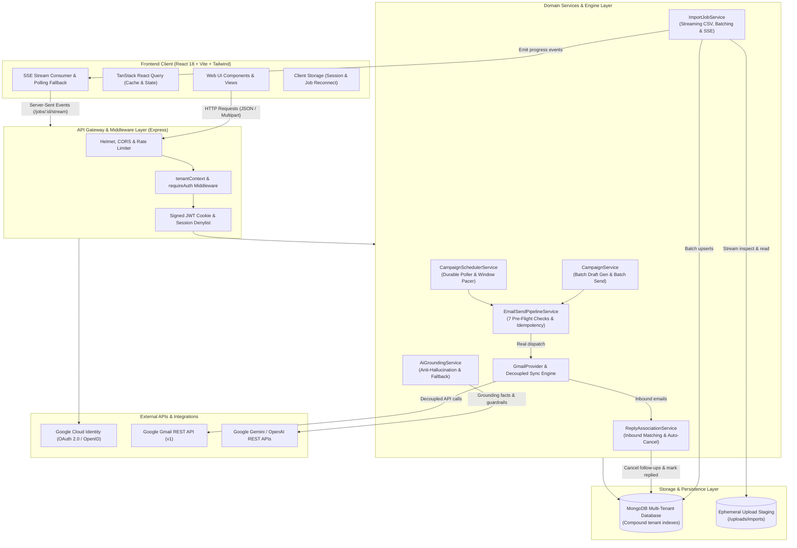
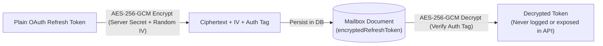
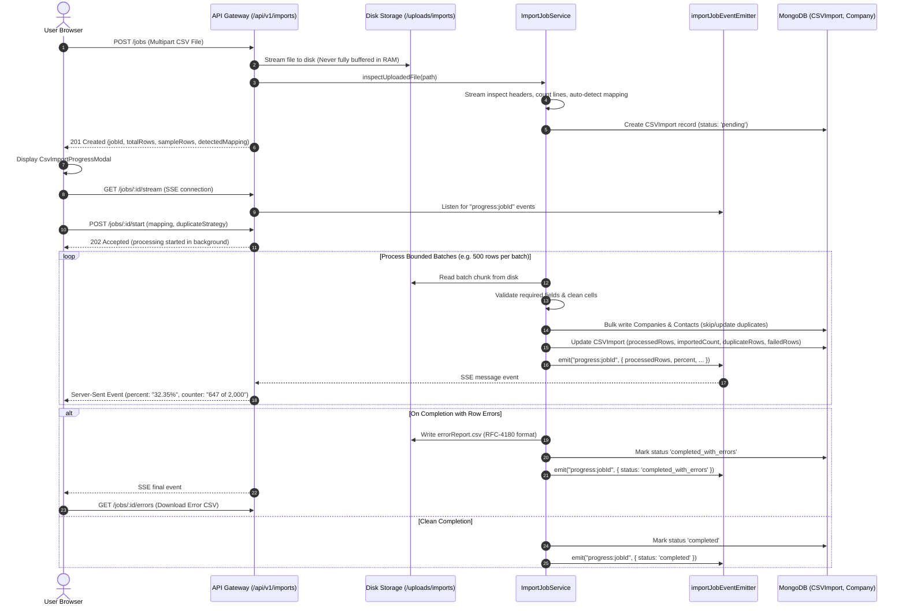
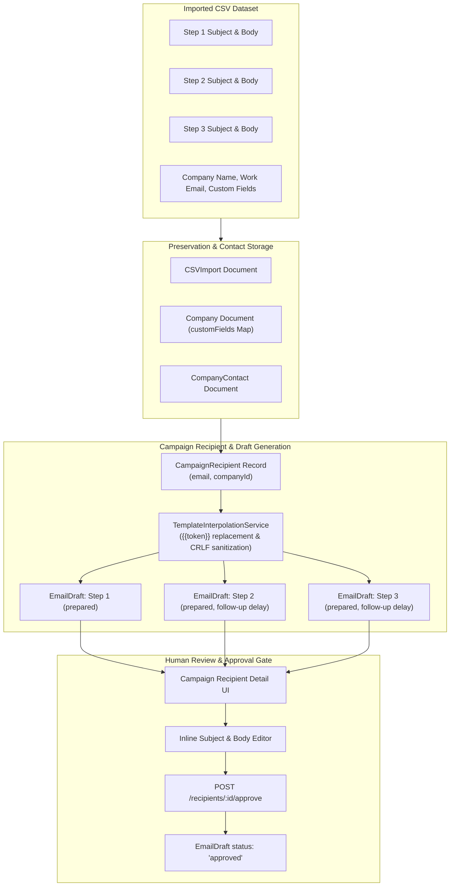
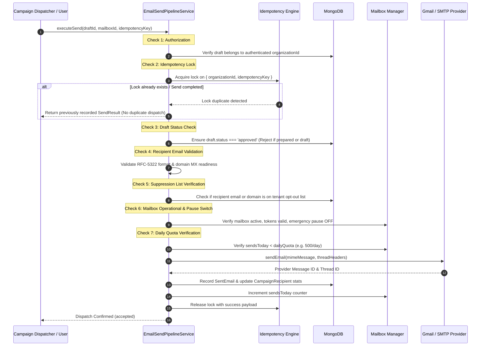
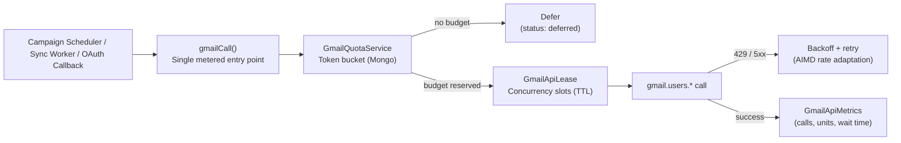
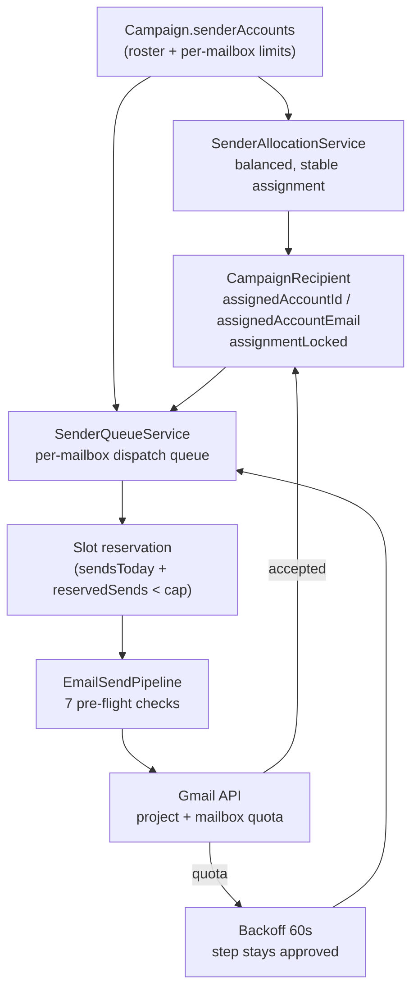
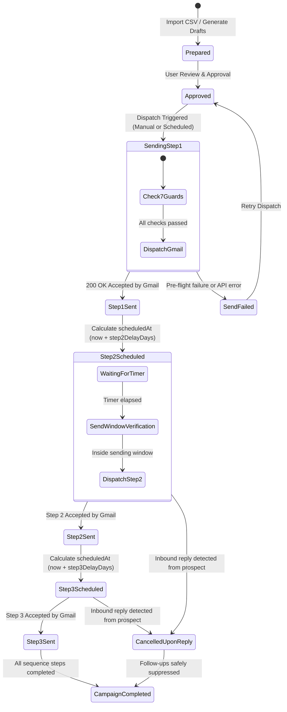
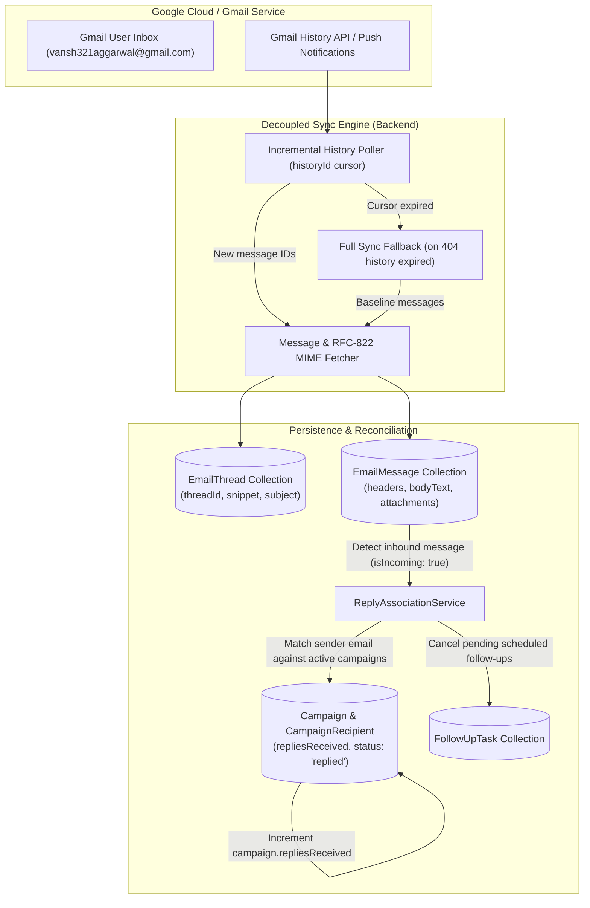
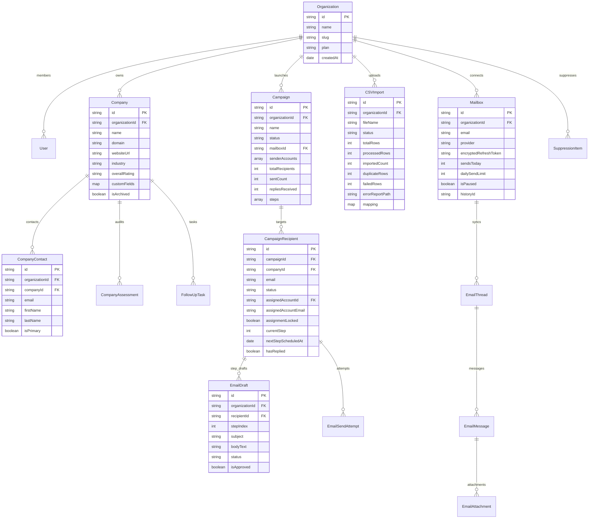

# Swaniki New Business Radar — Complete System Architecture & Specification

Swaniki New Business Radar is an enterprise-grade, multi-tenant B2B sales intelligence, prospect management, CSV outreach, and AI-assisted email automation platform built on the MERN stack.

---

## 1. System Topology & High-Level Architecture

The platform is structured as a TypeScript monorepo comprising a modern React 18 Single-Page Application (SPA) and an Express REST API backed by MongoDB.

---

## 2. Multi-Tenant Security, Session & Token Cryptography

### 2.1 Multi-Tenant Isolation
Every persistent document carries `organizationId`. Compound database indexes enforce tenant isolation at the query execution level:
- `{ organizationId: 1, name: 1 }`
- `{ organizationId: 1, email: 1 }`
- `{ organizationId: 1, idempotencyKey: 1 }`
- `{ organizationId: 1, status: 1 }`

### 2.2 Token Encryption at Rest
All third-party OAuth access and refresh tokens are encrypted at rest using **AES-256-GCM** with unique initialization vectors (IV) and authentication tags:

### 2.3 Spreadsheet Injection Defense (CWE-1236)
All imported CSV cells are sanitized on ingest. Any string beginning with `=`, `+`, `-`, `@`, `\t`, or `\r` is automatically prefixed with a single quote (`'`) to prevent formula execution in spreadsheet software.

---

## 3. Real-Time Streaming CSV Ingestion & Progress Architecture

The CSV import pipeline handles large outreach files (up to thousands of rows) without exhausting server memory or timing out.

### Reconnection Resilience Flow
If the user navigates away or reloads the browser:
1. `localStorage.getItem('radar_active_import_job_id')` restores the active modal immediately.
2. `GET /api/v1/imports/active` checks the database for any running job for the tenant.
3. The modal reconnects to the SSE stream or falls back automatically to 800ms polling.

---

## 4. Multi-Step CSV Outreach & Draft Generation Architecture

Swaniki preserves three email sequence steps (`Step 1`, `Step 2`, `Step 3`) from the prospect dataset, personalizing each contact's message before human approval.

---

## 5. Send Safety Pipeline & 7 Pre-Flight Verification Checks

No email leaves the system without passing through all seven verification layers and obtaining an atomic idempotency lock.

---

## 5b. Gmail API Quota Control (Per-Mailbox Token Bucket)

Google enforces **6,000 quota units per minute per Google user** on the Gmail API. A campaign that sends a few hundred messages can exhaust that ceiling on its own, so every Gmail call — sends, thread reads, history polls, attachment fetches, and even the OAuth `getProfile` call — passes through a shared, per-mailbox rate controller.

**Mechanics**
- **Token bucket** (`GmailQuotaLedger`, one row per mailbox): a capacity of `GMAIL_QUOTA_UNITS_PER_MINUTE * GMAIL_QUOTA_SAFETY_FACTOR`, refilled continuously at `capacity / 60` units per second, with a burst allowance of `GMAIL_QUOTA_BURST_UNITS`. Refill is applied both on reservation and when the live state is read, so a mailbox recovers automatically after an idle period.
- **Method cost table**: each Gmail method has a published unit cost (`messages.send` 100, `threads.get.full` 120, `threads.list` 10, `history.list` 2, `messages.list` 5, `messages.attachments.get` 20, `threads.modify`/`trash`/`delete` 10-20, `users.getProfile` 1). The cost is reserved *before* the call, so an expensive read can never be started without budget.
- **Concurrency leases** (`GmailApiLease`): at most `GMAIL_MAX_CONCURRENT_CALLS` in-flight Gmail calls per mailbox, shared across scheduler, sync worker and API requests. Leases expire via TTL so a crashed worker cannot deadlock a mailbox.
- **AIMD adaptation**: repeated 429s shrink the sustained rate factor; sustained success restores it. The controller therefore converges on a rate the mailbox can actually sustain instead of repeatedly hitting the ceiling.
- **Deferral, not failure**: when the bucket is empty, the send is deferred (`status: 'deferred'`, `deferredUntil` set), the draft stays `approved` with `canRetry: true`, and the caller receives `429 GMAIL_QUOTA_EXCEEDED` with `{ deferred: true, deferredUntil }`. The identical idempotency key resumes the send once the budget refills, so a deferred step can never deliver twice.
- **Observability**: `GET /api/v1/integrations/google/gmail/:emailAddress/quota` exposes the live budget plus per-method call/unit counters, wait time, retry count, and the last quota error timestamp.

### 5c. Shared Project Quota (The Ceiling That Does Not Grow With Mailboxes)

The **daily** Gmail API quota is granted per **Google Cloud project**, not per mailbox.
Connecting five Gmail accounts to the same project does not create five budgets — it
creates five spenders on one budget. The platform therefore meters a second, shared
bucket next to the per-mailbox bucket:

| Bucket | Key | Purpose |
| --- | --- | --- |
| Mailbox | `user:<emailAddress>` | Per-user 6,000 units/minute ceiling, burst control, AIMD rate factor |
| Project | `project:<GOOGLE_CLIENT_ID>` | Shared daily budget of the whole Cloud project (`GMAIL_PROJECT_DAILY_QUOTA_UNITS`, `GMAIL_PROJECT_QUOTA_SAFETY_FACTOR`) |

- A quota error penalises **both** buckets, so a mailbox that keeps hitting the ceiling
  also slows the whole project down instead of starving the other mailboxes.
- `GET /api/v1/integrations/google/gmail/:emailAddress/quota` returns the shared bucket
  as `projectQuota`, which is the only reliable way to see how much of the daily budget
  is left.
- **Operational consequence:** adding mailboxes increases throughput only until the
  shared project budget is exhausted. The drip pacing (§5d) therefore spreads the
  available budget over time instead of spending it in a burst.

---

## 5d. Multi-Mailbox Drip Mailing (One Recipient, One Mailbox)

A campaign may send from several connected Gmail accounts. The unit of scheduling is
not the campaign but the **mailbox**: every mailbox owns a small logical queue and
sends at its own pace.

**Guarantees**

1. **One recipient, one mailbox.** The queue only ever looks at recipients whose
   `assignedAccountId` matches the account it dispatches for. A thread never moves
   between inboxes, and a follow-up is always sent from the mailbox that sent the
   first step. Once a step was really sent, the assignment is *locked*
   (`assignmentLocked`) and can never be migrated.
2. **Balanced and stable allocation.** Duplicate addresses are skipped first (one
   prospect is contacted at most once per campaign), then every remaining recipient
   goes to the least loaded enabled account; ties break on the account id, so 100
   recipients over 3 mailboxes yield 34 / 33 / 33. An existing assignment is never
   moved automatically. A redistribution is only possible while nothing was ever
   sent — afterwards the assignments are frozen.
3. **Drip pacing, no catch-up bursts.** A mailbox sends at most one message per
   `minIntervalSeconds + jitter`. A paused, throttled or quota-limited mailbox
   resumes at its configured rate; it never flushes the backlog in one burst.
4. **Atomic caps.** The daily and hourly caps are claimed with a conditional update
   on the account (`sendsToday + reservedSends < cap`), so two workers can never
   book the same slot. The reservation is released in a `finally` block, and the
   counters are only incremented once the provider accepted the message.
   A manual "send batch" skips the drip *interval* (the operator explicitly asked
   for a batch) but never the daily and hourly caps — otherwise a single click
   could send hundreds of messages in a second and get the mailbox throttled. The
   mailboxes that hit a cap report themselves in `throttledAccounts` and keep
   their recipients queued.
5. **Unavailable accounts are held, never substituted.** A disconnected, revoked or
   paused mailbox is reported as *not authorized*. Its recipients stay assigned and
   are **held back** (orphaned) instead of being silently sent from another inbox.
   Only an owner/admin may migrate them with an explicit rebalance.
6. **Transient is not broken.** A reached cap or a missing due recipient is a
   *transient* state: it is reported live by `GET /campaigns/:id/sender-accounts`
   (`reasonCode`) but is never persisted as `unavailableReason`, which stays
   reserved for a mailbox that really cannot send (disconnected, revoked, paused,
   missing scope). A stale marker of a former outage is removed as soon as the
   mailbox works again.
7. **Replies are mailbox aware.** The reply association prefers the recipient whose
   `assignedAccountEmail` matches the mailbox the reply arrived in, and records the
   mailbox on `replyMailboxEmail`.
8. **Cancellation is final.** Cancelling a campaign sets `status: 'cancelled'` and
   invalidates every unsent step, so a worker that is already running finds nothing
   to send.

**Per-mailbox limits**

| Setting | Scope | Default |
| --- | --- | --- |
| `dailySendCap` | sends per mailbox and day | `CAMPAIGN_SENDER_DAILY_CAP_DEFAULT` (100), ceiling `CAMPAIGN_SENDER_DAILY_CAP_MAX` (2000) |
| `maxPerHour` | sends per mailbox and hour | `CAMPAIGN_SENDER_MAX_PER_HOUR_DEFAULT` (60), ceiling `CAMPAIGN_SENDER_MAX_PER_HOUR_MAX` (1000) |
| `minIntervalSeconds` | spacing between two sends | `CAMPAIGN_SENDER_MIN_INTERVAL_SECONDS_DEFAULT` (60) |
| `jitterSeconds` | randomized extra spacing | `CAMPAIGN_SENDER_JITTER_SECONDS_DEFAULT` (30) |

The campaign schedule can carry the same values as **campaign-wide defaults**; a
mailbox whose limits were tuned explicitly keeps its own values.

**Legacy behaviour is preserved:** a campaign without a roster keeps using its single
`mailboxId` sender and the classic batched sending path.

---

## 6. Multi-Step Follow-Up Scheduling & State Machine

When `Step 1` is successfully sent, the system schedules `Step 2` automatically based on the configured delay. If an inbound reply is detected at any time, subsequent steps are permanently cancelled.

---

## 7. Decoupled Gmail Integration & Inbound Reply Association

---

## 8. Entity-Relationship Data Model (ERD)

---

## 9. Fault Tolerance, Recovery & Reliability Summary

| System Component | Potential Failure Mode | Built-in Mitigation & Architecture Guarantee |
| :--- | :--- | :--- |
| **CSV Import Processing** | Network timeout during 10,000-row upload | File streams to disk in chunks; never stored in heap memory. Resumable via `/jobs/:id/retry`. |
| **Progress UI Tracking** | Browser closed or refreshed midway through import | State stored in MongoDB; client restores modal via `localStorage` and `GET /api/v1/imports/active`. |
| **Real-Time Streaming** | Client does not support SSE or proxy buffers events | Automatic fallback to bounded 800ms polling endpoint `GET /api/v1/imports/jobs/:id`. |
| **Outbound Email Sending** | User double-clicks "Send All" or network retries | Atomic idempotency lock on `{ organizationId, idempotencyKey }` guarantees exactly-once dispatch. |
| **Draft Approval Integrity** | Unapproved draft triggered by automated worker | Pre-Flight Check 3 strictly asserts `draft.status === 'approved'`; rejects with structured error. |
| **Follow-up Sequence** | Prospect replies after Step 1 is sent | Inbound reply association immediately marks recipient `replied` and cancels pending `Step 2`/`Step 3`. |
| **Gmail OAuth Token Expiry** | Expired refresh token or invalid grant | Automatic token refresh with exponential backoff; encrypted at rest via AES-256-GCM. |
| **Daily Sending Ceiling** | Mailboxes connected to one project share a single daily budget | Second shared project bucket meters all mailboxes of a project; a quota error penalises both buckets and the drip pacing spreads the budget over time. |
| **Duplicate Recipient** | Same address appears twice in a CSV | Allocation deduplicates by normalized address, so one prospect receives at most one message per campaign. |
| **Recipient Migrated Mid-Campaign** | A recipient is moved to another mailbox after a send | Assignments of contacted recipients are locked (`assignmentLocked`); redistribution is refused once anything was sent. |
| **Mailbox Unavailable** | Account disconnected, revoked or out of quota | The account is reported as not authorized, its recipients are held back instead of being silently sent from another inbox, and an owner/admin can migrate them explicitly. |
| **Two Workers Claim One Slot** | Scheduler and manual send race for the same hourly/daily budget | Slot reservation is a conditional atomic update (`sendsToday + reservedSends < cap`); the reservation is released in `finally`. |
| **Campaign Cancelled Mid-Flight** | A worker is already sending when the user cancels | Cancellation sets `status: 'cancelled'` and invalidates every unsent step, so the worker finds nothing left to send. |
